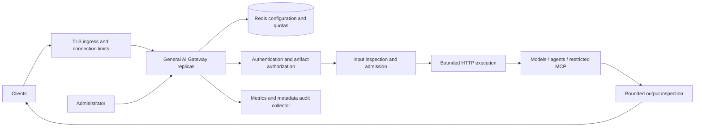

# Architecture
Author: Rajarshi

Each request captures one validated configuration object. The process does not
mutate that object during execution. A control-plane writer validates a complete
candidate and atomically compares its predecessor revision in Redis. Polling
readers install complete snapshots, avoiding partially updated policies.

Redis Lua enforces both quota windows in one operation using server time.
Allowances count admitted requests (including upstream failures), not successful
responses or actual token spend. Fixed windows permit boundary bursts.
Daily reset is UTC. Quotas do not reset when configuration changes.

HTTPX pools connections; TLS verification stays enabled, redirects and ambient
proxy inheritance are disabled. No automatic retry occurs: replaying agent/tool
calls could repeat side effects. Three transport/server failures open a local
circuit for 15 seconds. Circuit/concurrency limits apply per process, so total
upstream capacity scales with replica count; rate quotas remain global.

Response bodies are buffered for complete JSON inspection. Memory therefore grows
with active requests times response limit. No streaming, caching, autonomous tool
execution or tool-result follow-up is performed. Every agent's internal calls must
also traverse governed endpoints to be visible here.

MCP support is an application bridge for approved tools/call, resources/read and
prompts/get JSON-RPC requests using the 2025-06-18 version header. It targets
preconfigured JSON-only stateless adapters. It does not implement initialization,
session handling, SSE, discovery, OAuth, arbitrary notifications, batching or full
MCP client compatibility. Other MCP versions require an adapter and conformance work.
Agent support is generic JSON HTTP, not the A2A protocol.

Extension points: add provider-specific request adapters before execution,
semantic classifiers at input/output inspection, and durable approval orchestration
outside the request handler. New adapters must preserve auth, quotas, timeout,
response bounds and audit semantics.

## Protocol reference
The restricted bridge is intentionally narrower than the [MCP 2025-06-18 HTTP transport](https://modelcontextprotocol.io/specification/2025-06-18/basic/transports), which includes lifecycle and streaming behavior not implemented here.

## OAuth application authentication
Applications obtain access tokens from an external identity provider with the
client_credentials grant. The gateway uses the configured issuer's OIDC discovery
document and allowlisted JWKS endpoint to validate JWT signatures and claims. It
maps the verified client ID to the current tenant configuration, enforces scopes,
and then applies existing artifact and admission policies. An asynchronous,
bounded per-process cache avoids an IdP call on every request. OAuth changes retain
the same per-request configuration snapshot semantics as other policies.
